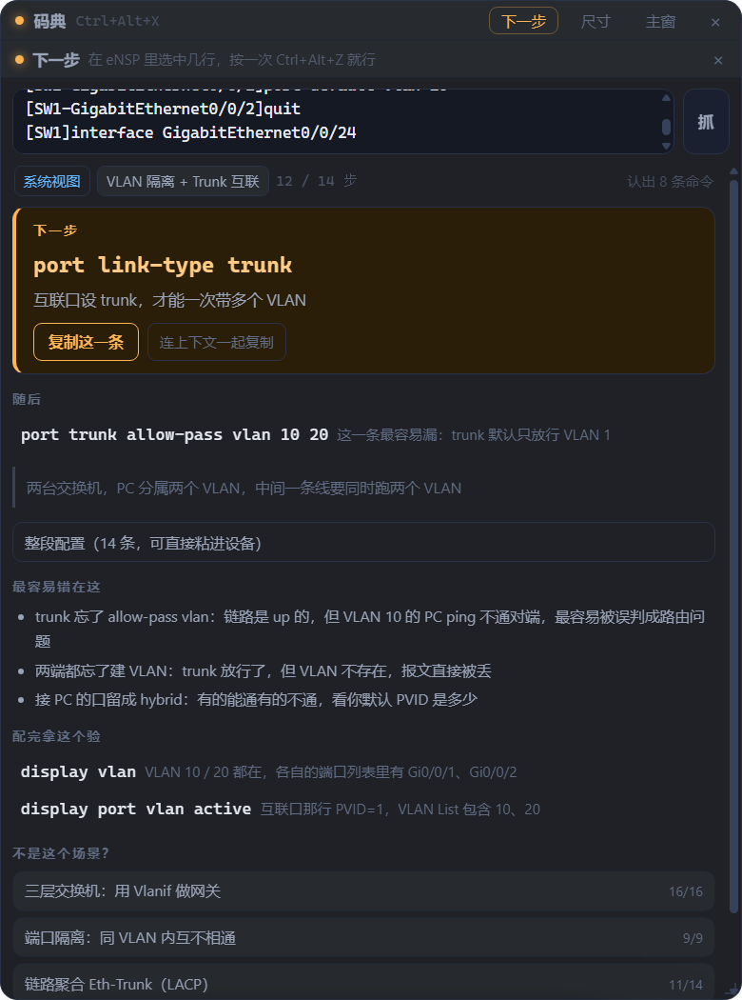
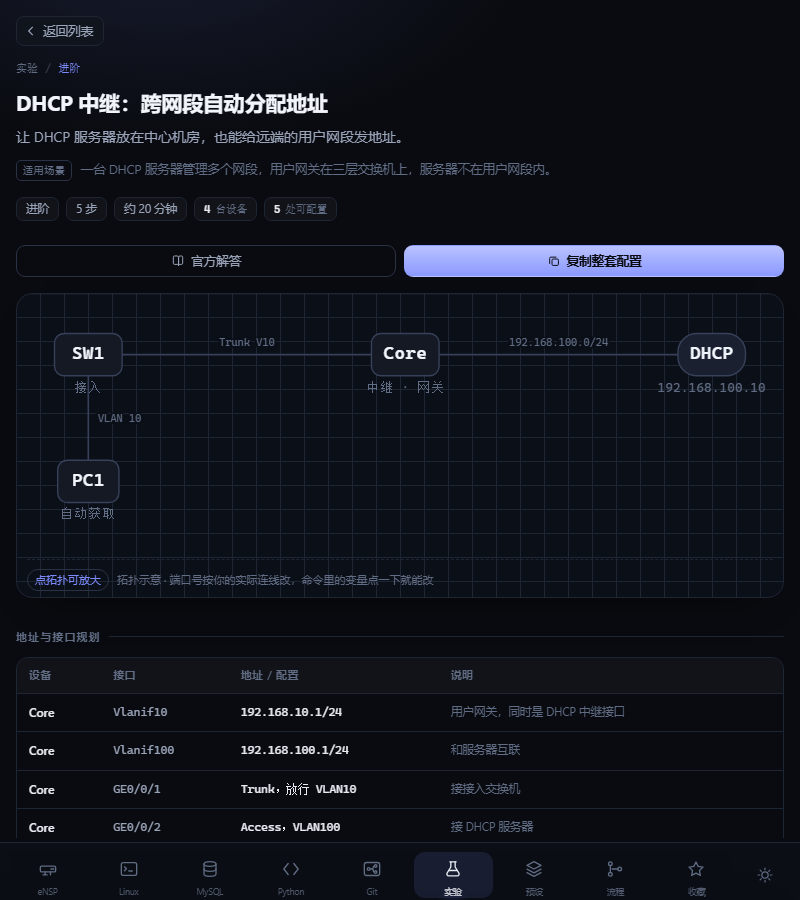

# 码典 CodeAtlas

> 可配置的代码大全。固定部分照抄，自主部分点一下就能改。

**华为 eNSP / JavaWeb / Web 前端 / 运维命令的中文速查库** —— 电脑 + 手机 + 网页三端共用同一份代码，
没有后端、没有构建步骤、零依赖，双击 `index.html` 就能跑。


抄代码最烦的不是「抄」，是**改**：教程里写 `vlan 10`、你环境里是 `vlan 30`；
一段配置散在三篇文章里；命令看不懂，搜索引擎还给同一篇教程。
CodeAtlas 把「哪里必须改」直接标在代码里 —— **固定部分灰色照抄，可配置部分琥珀色点一下就能改**。

### 桌面版：配到一半卡住了，按一次键

在 eNSP 里选中刚敲的几行，按 `Ctrl+Alt+Z`，悬浮窗直接告诉你**下一句该敲什么**，
以及**这一整段到底怎么写**（可整段复制）。42 条配置剧本、454 步，覆盖二层到 BGP、IPSec、MPLS VPN。



### 手机版：同一个 app，自动切单栏

| 手机端实验页（带拓扑图） | 窄窗口自动单栏 |
|---|---|
|  |  |

---

## 30 秒上手

| 平台 | 怎么用 |
|---|---|
| **Windows 10/11** | 下 [CodeAtlas-Setup.exe](../../releases/latest) 装，或直接双击 `index.html` |
| **Android 7.0+** | 下 [app-debug.apk](../../releases/latest) 装（设置里允许「未知来源」） |
| **只想看看** | 双击 `index.html`（Chrome / Edge），零安装 |
| **改代码** | `npm install` → `npm start`，改完 `Ctrl+R` 刷新 |

不用注册、不联网也能用。数据全在本机（桌面版 `%APPDATA%\CodeAtlas`，手机在 WebView 存储，
网页版在 localStorage），三端互不相通，迁移靠「知识包」导出 / 导入。

**四个区值得先看：** 左轨 4 个大图标是**专题**（eNSP / JavaWeb / Web 前端 / 系统与脚本），
点一下列表就只剩这个专题的内容；`Ctrl+K` 是全站搜索，支持 `dis isis` 这种缩写；
右上角 `知识包` 可以导入别人写好的内容包；桌面版额外有 `Ctrl+Alt+X` 透明悬浮窗。

---

## 目录

- [一、它解决什么](#一它解决什么) —— 八个功能点，各配真实例子
- [二、跑起来](#二跑起来) —— 三端安装、快捷键、悬浮窗、「下一步」
- [三、怎么加自己的代码](#三怎么加自己的代码) —— 片段 / 预设 / 实验 / 剧本的数据格式
- [三之二、不改代码加内容：知识包](#三之二不改代码加内容知识包) —— 一段 JSON 就导入
- [三之三、打包成应用](#三之三打包成应用windows--android) —— Windows / Android 出包步骤
- [四、目录](#四目录) —— 每个文件干什么
- [五、当前内容](#五当前内容) —— 内容规模、搜索匹配规则、专题组织、剧本引擎
- [六、下一步可以做的](#六下一步可以做的)
- [七、已知限制](#七已知限制) / [七之二、布局硬规则](#七之二布局的一条硬规则改样式前务必看)
- [八、设计说明](#八设计说明) —— 为什么这么设计，以及踩过的坑

---

## 一、它解决什么

抄代码最烦的不是"抄"，是**改**：

- 教程里写 `vlan 10`，你的环境是 `vlan 30` —— 得在几十行里找哪几个数字要换。
- 一套配置有六段，散在三篇文章里 —— 得来回翻。
- 命令看不懂，搜索引擎给的还是同一篇教程 —— 想知道每个参数到底干嘛。
- 卡在"该用 Trunk 还是 Access" —— 需要的是判断路径，不是命令列表。

所以做了这几件事：

**1. 自主配置区（琥珀色）**
代码里所有需要改的地方，用琥珀色块标出来，左上角一个「自主」角标。点一下弹出编辑器，带取值范围、默认值、为什么这么填的说明，改完代码实时更新。

固定部分灰色照抄，可配置部分琥珀色 —— 一眼分得清哪里能动、哪里别动。

**2. 预设库（整套代码）**
不只是一条命令，是一整套配置。列表上写清功能（"2 个业务 VLAN / 端口组批量下发 / 上行 Trunk 放通"），点进去是 6 段串好的完整配置，每段仍可独立修改，也能一键复制整套。

**3. 官方解答**
- 每条片段右侧「官方解答」→ 这条命令在做什么 / 关键参数 / 常见坑 / 官方文档来源。
- 代码里的**蓝色关键字可以直接点** → 弹出该命令的官方口径解释（全站 350 个命令词条）。
- **搜索支持缩写和模糊匹配**：输入 `dis isis` 会列出所有 `display isis ...`（`dis` 按词首命中 `display`），输入 `邻居` 会跨命令、片段、实验一起给结果。规则见「搜索是怎么匹配的」。
- 说明文字是人工整理的要点，正式依据以官方文档为准，附直达链接。

**文档链接已逐条核对官网**（2026-10 核过两遍）：

- 华为部分共 25 条外链，全部指向 `support.huawei.com` 上的**真实文档页**（`/enterprise/zh/doc/EDOCxxxxxxx/章节id`），不再指向搜索页。
- 产品系列与片段对齐：交换机片段指向 S5700 系列手册，AR 路由器片段（NAT、单臂路由）指向 AR 系列手册，不会出现"S5700 的配置去翻 S9300 文档"。
- 只用 `support.huawei.com` 一个域名。`info.support.huawei.com` 这个子域名暂时可访问，但实测有条目会被重定向回首页，所以全站不再使用。
- 命令词条按生态分流，不强行都指向华为：VRP 命令 → 华为命令参考；`git *` → git-scm.com；`CREATE TABLE` / `EXPLAIN` / `mysqldump` → MySQL 8.0 Reference；`df` / `du` / `find` / `systemctl` → man7.org；`docker` → docs.docker.com。
- 分级由 `data.js` 的 `cmdSrc` 控制，没列出的默认查华为命令参考。

**eNSP 20 条的「常见坑」按华为官方「常见配置错误」章节校过一遍**：

华为每本配置指南都有独立的「xxx常见配置错误」小节，是现成的权威坑位清单。对照下来改了这些：

- `dhcp-pool` 的示例代码**原来漏了 `interface Vlanif` + `dhcp select global`**。地址池写得再全，接口上没使能，一个包也不会回——这是照抄必然不通的硬错误，已补。
- `port-security` 里 shutdown 动作的恢复方式，原文写的 `undo shutdown` 不对，官方是 **`restart` 命令**；端口置 error-down 后默认不会自愈，要另配 `error-down auto-recovery`。
- `stp` 里「边缘端口收到 BPDU 会 err-down」这个说法把两层搞混了：默认只是**自动降级为非边缘端口**、重新参与 STP，只有配了 `bpdu-protection` 才 err-down。
- `svi` 的排查从 3 条补到官方完整的 5 个 Down 原因，并补上 VLANIF 创建失败的三种报错含义、两台交换机 VLANIF 互通的 UT/TG 检查。
- `trunk` 补了官方专门标注的坑：`port trunk pvid vlan` 只改 PVID，**不会**把接口加入 VLAN。
- `acl` 补了 inbound/outbound 方向（反了不报错、只是不过滤）、2000/3000 段的匹配能力差异。
- `static-route` 补了优先级（静态 60 vs OSPF 10）和为什么"配了却不进路由表"。
- `nat-server` 补了 NAT 回环（内网访问自己公网 IP 不通）和全端口映射会把设备管理口一起转走。


**4. 工作流（分支 / 选项）**
不是命令列表，是判断树。点一个节点 → 展开它的所有分支，分支之间用连线连起来，像流程图一样往下走，走到绿色结论节点 → 直接给出对应配置。

现已内置五条：VLAN 跨设备方案怎么选、终端上不了网逐层排查、OSPF 邻居起不来按五条查、不同 VLAN 之间 ping 不通、NAT 该配哪一种。

**5. eNSP 实验（从零做到通）**
预设库给的是"一段配置"，实验给的是"一台台搭出来"。每个实验都是完整一页：

1. **目标 + 适用场景** —— 这个实验解决什么真实问题，什么时候该用；
2. **拓扑图** —— SVG 画的设备与连线，链路上标着 Trunk / 地址，跟 eNSP 里拖出来的样子对应；
3. **地址与接口规划表** —— 哪台设备的哪个口配什么地址，照着抄不用猜；
4. **配置步骤** —— 按设备/顺序拆开，每步都能改（变量和片段是同一套机制）；
5. **验证方法** —— 敲哪条命令、看到什么输出才算成功；
6. **常见错误** —— 这个实验最容易踩的坑，照着抄最容易翻车的地方。

现有 6 个实验，27 个步骤、26 个可配置变量：

| 实验 | 层级 | 步数 | 设备数 | 练什么 |
|---|---|---|---|---|
| 端口隔离 | 入门 | 4 | 4 | 同 VLAN 内互相隔离，只留一个口通网关 |
| 浮动静态路由 | 入门 | 4 | 4 | 主链路断自动切备份，优先级差值 |
| DHCP 中继 | 进阶 | 5 | 4 | 服务器集中在一处，给远端网段分地址 |
| DHCP Snooping + IPSG | 进阶 | 4 | 5 | 防私接路由器、防改 IP |
| OSPF 多区域 + 路由汇总 | 进阶 | 5 | 5 | ABR、Area 0 规则、abr-summary |
| MSTP 多实例 | 综合 | 5 | 3 | 两条链路互为备份、VLAN 负载分担 |

手机上拓扑默认缩到整幅可见（一眼看清有几台设备、怎么连），点一下放大到可横滑的尺寸看端口和地址 —— 默认不裁、也不强迫你盲滑。

**6. 全站搜索**
不用先点分类。输入关键词直接搜全部 38 条片段 + 5 套预设 + 5 条工作流，结果按来源分组显示，命中词高亮。
搜的是全字段：标题、描述、标签、**代码正文**、变量名 —— 记得半条命令也能搜到。

**7. 收藏 / 皮肤**
卡片右上角星号收藏，左轨「收藏」入口汇总三类内容。常用的十来条放这里，不用每次翻分类。

左轨底部的调色盘按钮开皮肤面板，**8 套配色**任挑，点一下即时生效，选择会记住：

| 皮肤 | 底色 | 适合 |
|---|---|---|
| 深空 | 靛蓝夜色 | 默认，暗环境 |
| 日间 | 白纸黑字 | 白天、投屏 |
| 极光 | Nord 冷灰蓝 | 久看不闷 |
| 极夜 | 纯黑 OLED | 夜间、省电屏 |
| 终端 | 黑底荧光绿 | 喜欢终端质感 |
| 墨玉 | 墨绿灰 + 玉青 | 低对比、温润 |
| 暖砂 | 米黄纸感 | 长时间看代码 |
| 樱雾 | 淡粉紫 | 浅色里偏柔的一档 |

没手动挑过就跟随系统深浅色。桌面端换肤时**已经开着的悬浮窗也会跟着变**，
不用关掉重开 —— 那张半透明卡片的底色是跟着皮肤走的，透明本身不受影响。


**8. 知识包（内容可插拔）**
内容不是写死在应用里的。缺哪部分，让 AI 按格式产一段 JSON 粘进来就能用 —— 校验、合并、刷新，跟内置内容一样出现在侧栏、能搜索、能改变量。详见「三之二」。
这样「要不要打包成 App」就不再是个卡点：**外壳稳定，内容随时换。**

---

## 二、跑起来

### 电脑（三种方式，按需选）

| 方式 | 怎么做 | 适合 |
|---|---|---|
| 直接开网页 | 双击 `index.html`（Chrome / Edge） | 只想看看效果 |
| 装桌面版 | 跑 `dist/CodeAtlas-Setup-1.1.4.exe` 安装 | 日常使用，独立窗口、快捷方式 |
| 开发模式 | `npm install` 后 `npm start` | 改代码，改完 `Ctrl+R` 即刷新 |

### 手机

- **装 APK**（推荐）：把 `android/app/build/outputs/apk/debug/app-debug.apk` 传到手机安装。
- **不想装**：电脑上 `python -m http.server 8080`，手机浏览器打开 `http://<电脑IP>:8080`。

界面在 860px 以下自动切手机布局：底部导航 + 全屏详情 + 底部抽屉式编辑器。

### 常用命令

```bash
npm start              # 开发模式（Electron 窗口）
npm run dist           # 出 Windows 安装包（dist/CodeAtlas-Setup-*.exe）
npm run android:apk    # 出 Android debug APK
npm run www            # 只重新生成 www/（改了 assets 后要先跑，再 cap sync）
npm run icons          # 重新生成所有图标和启动图
npm run shots          # 启动成品自动截图，做界面回归
```

### 快捷键
- `Ctrl+Alt+Z` — **抓下一步**：自动复制你选中的几行，告诉你 eNSP 里下一句敲什么（仅桌面版，按一次）
- `Ctrl+Alt+X` — 显示 / 隐藏悬浮窗（仅桌面版）
- `⌘K` / `Ctrl+K` — 聚焦搜索（全站）
- `Ctrl+I` — 打开知识包（仅桌面版）
- `Enter` — 搜索框里直接打开第一条结果
- `Esc` — 依次关闭：下一步面板 → 解答面板 → 变量编辑器 → 清空搜索 → 退出详情
- `Alt` — 唤出桌面版菜单栏；`F12` 开发者工具；`F11` 全屏

### 悬浮窗模式（桌面版，v1.1.0 起）

按 `Ctrl+Alt+X`，冒出来一个**无边框的透明小窗**，浮在所有窗口最上面（全屏的 eNSP、IDEA 也压得住）。
再按一次就消失 —— 消失之后它既看不见、也点不到，鼠标会直接落到下面的程序上，
不挡你拖线、不挡你敲命令。

| 想干什么 | 怎么做 |
|---|---|
| 挪位置 | 按住顶部那条细横条拖 |
| 改大小 | 拖右下角小三角；或点横条上的「尺寸」在 420 / 520 / 680 三档间切 |
| 更透明 | 菜单 `视图 → 悬浮窗不透明度`：100% / 92% / 82% / 72% |
| 回主窗口 | 横条上的「主窗」，或托盘图标右键 |
| 热键被占用时 | 托盘图标右键 →「显示 / 隐藏悬浮窗」 |

尺寸、位置、透明度存在 `hud-state.json`（和主窗口的 `window-state.json` 分开），下次打开还是那样。
最小 320×240，主窗口本体也从 900×560 放宽到 360×280。

> **为什么是「按一下切换」而不是「按住才显示」**：Electron 的全局快捷键只能拿到别的程序里的
> *按下* 事件，拿不到 *松开* 事件 —— 那需要挂系统级键盘钩子（原生插件）。按一下切换反而更好用：
> 看代码、滚页面、复粘都不用一直按着键。

### 下一步：在 eNSP 里卡住时用（桌面版，v1.1.1 起；v1.1.2 起按一次就行）

配到一半，忘了下一句该敲什么，或者不确定这一整段到底怎么写 ——
**在控制台里选中刚敲的几行 → 按 `Ctrl+Alt+Z`**。就这一下。

`Ctrl+C` 那一步程序替你按了（注入前会先等你把手上的 Ctrl+Alt 松开，
不然前台收到的是 `Ctrl+Alt+C`，等于没复制）。你不需要先复制再按热键。

悬浮窗会弹出来，直接告诉你三件事：

1. **下一句该敲什么**（大字，带「为什么敲这条」）
2. **随后几步**（避免敲完一句又卡住）
3. **整段配置**（展开就能整段复制，直接粘进设备）

面板长这样：认出「接口视图 · Gi0/0/24」→ 下一步 `port link-type trunk`
→ 随后 `port trunk allow-pass vlan 10 20`（「这一条最容易漏：trunk 默认只放行 VLAN 1」）
→ 整段 14 条 → 最容易错在这 3 条 → 配完拿什么验。

| 想干什么 | 怎么做 |
|---|---|
| 再抓一次 | 再按一次 `Ctrl+Alt+Z`（还是按一次，复制照样它来） |
| 手动复制了别的 | 面板开着时，你在别处每 `Ctrl+C` 一次它就自动重算 |
| 不是这个场景 | 底下有「不是这个场景？」给你换 |
| 当手册翻 | 空面板下面列着全部 42 条主线，点开看完整步骤 |
| 只想看一眼就关 | 点 ×、按 `Esc`，或拖到一边继续敲 |

热键抓出来的面板**不抢焦点** —— 你可以一边看着它念，一边在 eNSP 里继续敲，
下一个热键也照样能抓（抢了焦点的话前台就变成面板自己，自动复制会被跳过）。

**它是怎么认出你走到哪的**：

- 从提示符判断视图 —— `<SW1>` 用户视图、`[SW1]` 系统视图、
  `[SW1-GigabitEthernet0/0/1]` 接口视图、`[AR1-ospf-1-area-0.0.0.0]` 区域视图
- 认缩写 —— `int g0/0/24` 等于 `interface GigabitEthernet0/0/24`，`sys` 等于 `system-view`
- 丢掉噪音 —— 设备日志、`Error: ...` 报错、`display` 的输出都不会被当成命令
- 在你的命令序列里找「最长的一段连续匹配」，所以你只复制中间几行也认得出

> **为什么走剪贴板而不是直接读 eNSP 窗口**：eNSP 的 CLI 是它自己画的控件，
> 里面的文字不属于 Windows 的标准文本框，Electron 拿不到。剪贴板是唯一可靠又不用装驱动的方式。
> 顺带的好处是：**它完全不知道你在敲什么，只有你选中那几行被读一次**，不监听键盘、不截屏。
>
> 替你按 `Ctrl+C` 的那层在 `electron/copysel.js`：常驻一个 PowerShell，
> 用 `GetAsyncKeyState` 等修饰键松开、`keybd_event` 注入 `Ctrl+C`、
> `GetForegroundWindow` 判断前台是谁。前台如果是本程序自己就跳过，绝不动你的剪贴板。
> 助手起不来（被安全策略拦住之类）时自动退回「只读剪贴板」，不报错、不挡面板。
> 自检：`node _dev/check-copysel.js`（会真开一个靶子窗口验证注入生效）。

### 深链
`#/ensp/vlan-create`、`#/presets/preset-l3-office`、`#/flows/net-troubleshoot`、`#/labs/lab-mstp-instance`、`#/fav`，末尾加 `/docs` 直接打开官方解答。

---

## 三、怎么加自己的代码

只改 `assets/data.js`，不用碰 `app.js`。

```js
{
  id: 'my-snippet',
  title: '标题',
  desc: '一句话说明它解决什么问题',
  tags: ['标签'],
  device: 'S5700',
  level: '入门',
  code: `system-view
vlan {{vlanId}}
 quit`,
  vars: {
    vlanId: {
      label: 'VLAN 编号',
      value: '10',        // 默认值
      type: 'int',        // int | text
      min: 1, max: 4094,  // 可选，会做校验
      hint: '1–4094',     // 编辑器里的小字提示
      desc: '为什么这么填',  // 编辑器里的说明
      multiline: false    // true → 用多行输入框
    }
  }
}
```

规则很简单：**`{{变量名}}` 就是自主配置区**，变量名必须出现在 `vars` 里。

其他可选字段：

| 字段 | 作用 |
|---|---|
| `variants` | 代码级分支，工具栏出现一组小胶囊切换写法 |
| `docs` | 官方解答内容：`{ secs:[{h,p,ul,code}], src:{n,u} }` |
| `flow` | 关联的工作流 id |

`src.u` 必须是**能打开的官方文档页**，不要填搜索页——华为的 `support.huawei.com/enterprise/zh/search?keyword=` 这类地址已经会返回"内容到期已下架"。

命令词条的文档来源在顶层 `cmdSrc` 里分组：

```js
cmdSrc: {
  linux:  ['sudo','systemctl', ...],   // → man7.org
  git:    ['commit','revert', ...],    // → git-scm.com
  mysql:  ['create','explain', ...],   // → dev.mysql.com
  docker: ['docker']                   // → docs.docker.com
}                                      // 没列出的 → 华为命令参考
```

预设、工作流、实验分别写在 `presets` / `flows` / `labs` 数组里，文件头部有完整注释。

实验（`labs`）的结构和片段不一样，是"一整个场景"：

```js
{
  id: 'lab-xxx', title, level: '入门|进阶|综合', minutes, goal, scene,
  topo: { h: 260, nodes: [{ id, label, sub, x, y, t: 'switch|router|pc' }], links: [['SW1','SW2','Trunk V10/20']] },
  plan: [{ dev, intf, ip, note }],          // 地址与接口规划表
  vars: { ... },                            // 全实验共用一套变量
  steps: [{ title, note, ref: '片段id(可选)', code }],
  verify: [{ cmd, hope }],                  // 怎么验证做对了
  pitfalls: ['...'],                        // 常见错误
  docs: { secs, src }
}
```

拓扑节点坐标直接用 SVG 用户坐标（0–760 宽），`links` 的第三项是链路标签，可省略。画布会按节点包围盒自动裁 viewBox，不用手算留白。

---

## 三之二、不改代码加内容：知识包

上面那种改 `data.js` 的方式适合你自己长期维护。但更常见的场景是：**手头缺 OSPF 的那部分，想让 AI 补，又不想动源码。**

所以内容层做成了可插拔的：**应用是外壳，内容是包**。

### 怎么用（3 步）

1. 左下角列表页脚点 **知识包** → 打开「导入」；
2. 点 **复制给 AI 的格式说明**，把这段丢给任意 AI（说是要做「码典知识包」），让它按里头的 JSON 结构产出；
3. AI 给的答案整段粘回来（带不带 ``` 代码块都能识别，前后有客套话也能自动截取）→ **校验** → **确认导入**。

输入框上方有 **粘贴** / **清空** 两个按钮：粘贴直接读剪贴板（桌面版走主进程，最省事），
换新包时点清空一键扔掉上一份，不用手动全选删除。右边还会显示「N 字 · N 行」，粘完一眼确认。

链接字段（`docs.src.u`）的写法很宽松：前导空格、大写 `HTTPS://`、中文冒号、漏写协议、
反斜杠都会被**自动修正**而不是拦住导入；只有 `http://` 会留一条提示建议换 https（不强制，有的站只有 http）。

页面会自动刷新，新内容就跟内置的一样：出现在侧栏、能搜索、能收藏、变量能改、实验有拓扑。

### 为什么这样设计

| | 直接打包成 App | 做成知识包 |
|---|---|---|
| 加内容 | 改源码 → 重新打包 → 重新安装 | 粘一段 JSON，刷新就生效 |
| 内容来源 | 只能自己写 | 任何 AI、同事、别人导出的包 |
| 版本更新 | 整包重发 | 同 id 覆盖，其他内容不动 |
| 出问题 | 可能把应用搞坏 | 校验不过就进不来；删包即回滚 |

这也是「先别急着打包」的原因：外壳稳定、内容可换，打包成 Tauri / Capacitor 之后照样能导包，不用为了加一章 OSPF 重新发版。

### 包长什么样

```json
{
  "id": "ospf-adv",
  "name": "OSPF 进阶",
  "version": "1.0",
  "desc": "一句话说明补了什么",
  "categories": [
    { "id": "ospf-adv", "name": "OSPF 进阶", "icon": "switch", "short": "OSPF", "ext": "cfg",
      "items": [ { "id": "...", "title": "...", "desc": "...", "tags": [], "code": "...", "vars": {}, "docs": {} } ] }
  ],
  "labs": [], "presets": [], "flows": [],
  "cmd": { "命令词": { "p": "解释", "eg": "示例" } },
  "keywords": ["要高亮的词"]
}
```

五个部分都是可选的，但至少要有一项有内容。片段的 `items`、实验的 `labs`、预设的 `presets`、工作流的 `flows` 结构跟 `data.js` 里完全一致，所以**现有内容可以全量导出，改完再导回来**。

仓库里带了一个现成的例子：`examples/ospf-adv.pack.json`（2 个片段 + 1 个实验 + 1 条排查流程 + 2 个命令词）。直接打开它复制全文、粘进「导入」里，就能看到完整效果 —— 也可以拿它当模板给 AI 参考颗粒度。

### 校验会挡什么

导入前跑一遍规则，**错的挡住、建议放行**：

| 会挡住（导入失败） | 只提醒（能导入） |
|---|---|
| JSON 语法错（含中文引号、多余逗号、没闭合，报错会翻成中文并指到第几个字符） | 片段没写 `desc` |
| 代码用了 `{{x}}` 但 `vars` 里没有 `x` | 变量没写 `desc` 或没默认值 |
| 分类 / 片段 / 实验等 id 跟已存在的撞了 | 实验没写验证方法或常见错误 |
| 拓扑节点坐标超出画布，或连线指向不存在的节点 | 流程节点没写 `label` |
| 预设引用了不存在的片段、流程没有结论节点 | |

`id` 撞车是最常见的：说明你的包和现有内容重名了。改个名就行；如果是**更新自己之前导入的包**，保持同一个包 id 即可，会自动覆盖旧版本。

### 想覆盖内置内容：加 `"overwrite": true`

默认情况下**外来包不许改内置内容** —— 同 id 直接判冲突，导入按钮都不给。
「复制全量 JSON / 下载 .json」导出来的包自动带了这个字段，所以你改完导回去会就地替换原条目：

```json
{ "id": "my-backup", "name": "我的备份", "overwrite": true, "categories": [ ... ] }
```

没写这个字段的包永远是「只增不改」，同事发你的包不会悄悄动你的数据。

### 导入不成功怎么办（按现象对号）

| 看到的现象 | 原因 | 怎么办 |
|---|---|---|
| 红框「这些 id 已经被占用了」 | 片段/实验 id 跟内置或已装的包重名 | 改 id；或更新自己的包就沿用同一个包 id；要改内置内容就加 `"overwrite": true` |
| 红框「有多余的逗号」「属性名要用双引号」 | JSON 语法错 | 提示会指到第几个字符，照着改 |
| 红框「代码用了 {{x}} 但 vars 里没定义」 | 占位符和变量表对不上 | 在 `vars` 里补上同名条目，或把代码里的 `{{x}}` 改成普通文字 |
| 校验通过、也提示「已导入」，但列表里找不到 | 实验/预设/工作流没写 `topic`，被算到了别的专题 | 在条目里加 `"topic": "javaweb"`（可选值 `net` / `javaweb` / `web` / `tool`）；不写则跟随包的第一个分类 |
| 侧栏多出一个没见过的专题 | 包的分类 id 不属于任何现有专题 | 正常行为，未归类分类会自动单独成专题；想并进现有专题就把分类 id 写成 `javaweb-servlet` 这种已有 id |
| 导入后变量点不动 | 片段没写 `vars` | 补上 `vars`，里面有 `value` 才会显示成可点色块 |

自己排查时可以直接跑这两条（不需要打开应用）：

```bash
node _dev/check-import.js    # 走完整导入链路：校验 → 冲突 → 写入 → 合并 → 是否可见
node _dev/shot-import.js     # 真界面回归：粘包、校验、确认导入、自动刷新后截图
```

### 数据存在哪

导入的包存在浏览器 `localStorage`（键 `codeatlas.packs.v1`），启动时合并进内置数据。

- 换设备、清缓存会丢 —— 导出页有「复制全量 JSON」和「下载 .json」，等于备份；
- 「已装」页可以单独删某个包，删完刷新即回到内置内容；
- 打包成 App 后同样适用：包存在应用自己的 WebView 里，不随版本升级丢失。

---

## 三之三、打包成应用（Windows / Android）

网页版和安装包**共用同一份 `index.html` + `assets/`**，打包只是给它套一层原生外壳，
内容、样式、逻辑一行都不用改。装好之后再加内容仍然走「知识包」，不需要重新打包。

### 桌面（Windows）

```bash
npm install        # 首次
npm run dist       # 出安装包，产物在 dist/
```

| 产物 | 说明 |
|---|---|
| `dist/CodeAtlas-Setup-1.1.4.exe` | 安装版，可选目录、建桌面和开始菜单快捷方式 |

外壳在 `electron/main.js`，它负责这些事：

- 用自定义 `app://bundle/` 协议加载页面（**不是 `file://`**）。这样 localStorage 有稳定的 origin，换盘符、升级版本都不丢数据。
- 单实例：重复双击只会把已有窗口叫到前面，不会开出第二份。
- 记住窗口大小与位置；最小 360×280（再小就只能看见一两行内容了）；菜单栏默认收起，按 `Alt` 唤出。
- 页面里的官方文档链接一律交给系统浏览器，不在应用内新开窗。
- 主进程日志写到 `%APPDATA%\CodeAtlas\logs\main.log`（菜单：文件 → 查看运行日志），
  出问题时让用户发这个文件即可定位。

**两个默认关闭的开关，都是有原因的：**

1. **渲染进程沙箱**。部分机器上（安全软件策略、Windows 漏洞防护的特定项、某些虚拟机），Chromium 的渲染沙箱初始化就会失败，
   表现是「窗口一闪就没了」，日志里能看到 `STATUS_BREAKPOINT`。本应用完全离线、只加载自己打包的静态文件，
   `contextIsolation` 开着、`nodeIntegration` 关着，关掉沙箱的代价很小。要用沙箱就设环境变量 `CODEATLAS_SANDBOX=1`。
2. **硬件加速**。界面以文字和 SVG 为主，关掉肉眼几乎看不出差别，却能避开虚拟机 / 远程桌面 / 老旧显卡驱动上
   GPU 进程反复崩溃。想开就设 `CODEATLAS_GPU=1`。

打包时用 `electronDist` 指向 `node_modules/electron/dist`，省掉重新下载 100MB+ 运行时那一步
（国内网络下这一步经常卡住）。

### 手机（Android）

```bash
npm run android:apk     # 产物：android/app/build/outputs/apk/debug/app-debug.apk
```

把 apk 传到手机安装即可（首次需允许「安装未知来源应用」）。要正式签名发布用 `npm run android:release`。

原生适配写在 `assets/native.js`，**只在真机容器里生效**，浏览器和桌面版打开时它整个是空转的：

- **状态栏**跟随深浅主题变色，内容不压到状态栏下面
- **Android 物理返回键**：先关弹层 → 再退出详情页 → 都不在了才两次按退出应用（防误触）
- **导出知识包**走「写文件 + 系统分享」，因为 WebView 里 `<a download>` 不生效
- 底部导航按 `env(safe-area-inset-bottom)` 留白，刘海屏 / 手势条不会压住内容

构建环境：JDK 17、Android SDK Platform 35、Build-Tools 35。国内网络已把 Gradle 换成腾讯云镜像、
Maven 换成阿里云镜像（见 `android/build.gradle` 与 `android/gradle/wrapper/gradle-wrapper.properties`）。

### 装好之后怎么加内容

不用重新打包。走上一章的**知识包**：粘 JSON → 校验 → 导入，刷新即生效。

---

## 四、目录

```
code-atlas/
├── index.html              骨架（只有 2KB，所有内容都在 assets 里）
├── assets/                 网页版与两个安装包共用的同一份前端
│   ├── data.js             内置内容第一部分：eNSP 主干 + Linux / MySQL / Python / Git
│   ├── topics.js           专题层：专题 → 分类的映射表 + 内容合并器（apply）
│   ├── search.js           搜索内核：分词、加权、分组排序（可单独在命令行验证）
│   ├── nextstep.js         「下一步」引擎：解析终端回显 → 匹配配置剧本（可单独验证）
│   ├── ensp/               eNSP 内容分片（入门→进阶→高级 + 实验 + 命令 + 剧本）
│   ├── javaweb/            JavaWeb 专题分片（Servlet / JSP / JDBC / MVC / 部署 + 实训）
│   ├── weblegacy/          Web 前端（旧版）专题分片（HTML/CSS、JS、jQuery、兼容实战）
│   ├── packs.js            知识包引擎：解析、校验、合并、导入导出
│   ├── native.js           原生容器适配（状态栏 / 返回键 / 导出分享），浏览器里是空转的
│   ├── skins.js           皮肤表：8 套配色的名字 / 深浅 / 预览色 + 切换与跨窗口同步
│   ├── app.js              逻辑：渲染、变量编辑、高亮、实验拓扑、工作流、全站搜索、收藏、皮肤
│   ├── hud.js              悬浮窗交互：拖动、缩放、透明度、尺寸档位
│   ├── hudnext.js          「下一步」面板：渲染、复制、候选切换（仅悬浮窗）
│   └── styles.css          样式：8 套皮肤变量 + 悬浮窗透明层 + 响应式 + 安全区
├── electron/main.js        桌面外壳：app:// 协议、单实例、窗口记忆、悬浮窗、热键、菜单、日志
├── electron/preload.js     主进程 ↔ 页面桥：悬浮窗控制 + 剪贴板读写
├── electron/copysel.js     替用户按 Ctrl+C：等修饰键松开 → 注入 → 前台是自己就跳过
├── android/                Capacitor 生成的 Android 工程（只改了图标、名称、清单、镜像源）
├── build/                  图标源文件（icon.ico / icon.png / android 各密度）
├── examples/               示例知识包，可直接导入试手
├── _dev/                   命令行自检（不参与打包）
│   ├── check-all.js        全站内容：id 唯一、变量闭合、ref 有效、专题归属、幂等
│   ├── check-import.js     知识包导入全链路：校验 → 冲突 → 写入 → 合并 → 是否可见
│   ├── check-search.js     搜索 25 个查询 + 首条结果断言
│   ├── check-recipes.js    配置剧本：id / 全角符号 / **视图链** / who 连续性
│   ├── check-nextstep.js   「下一步」引擎：41 条断言，含 41 个剧本主线批量回推
│   ├── check-copysel.js    自动 Ctrl+C：真开靶子窗口验证注入真的进了剪贴板
│   ├── check-grab.js       端到端：按**一次**热键 → 复制 → 面板拿到内容（不需要人按 Ctrl+C）
│   ├── target-window.js    上面两个脚本共用的「靶子窗口」，冒充 eNSP 控制台
│   ├── recycle-dir.py      走回收站删 dist/win-unpacked（绕开 safe-delete 护栏）
│   ├── shot-import.js      导入的界面回归（粘包 / 校验 / 确认导入 / 刷新后截图）
│   ├── shot-hud.js         悬浮窗 / 窄窗口截图回归
│   ├── shot-next.js        「下一步」面板截图 + 探针断言
│   └── hud-screen-test.js  全屏 A/B 采样，验证透明窗真的透出桌面
├── scripts/
│   ├── prepare-www.js      生成 www/（Android 打包用的静态资源目录）
│   ├── make-icon.py        生成 Windows 图标 + Android 自适应图标 + 启动图
│   └── shot-regress.py     启动打包后的成品，自己截图做回归
├── www/                    构建产物：给 Capacitor 的纯净静态目录（勿手改）
├── dist/                   构建产物：桌面 exe（勿手改）
└── README.md
```

加载顺序 `data.js → topics.js → search.js → ensp/*.js → javaweb/*.js → weblegacy/*.js → packs.js → native.js → nextstep.js → app.js → hud.js → hudnext.js`：各专题分片先把自己的内容并进数据层（按 id 去重、按难度排序），packs.js 再把已导入的包合进来，所以应用完全不用感知「哪些是内置、哪些是导入的」。**新增分片必须排在 packs.js 之前**，否则知识包会先合并、内置内容后合，去重就不起作用了。`nextstep.js` 放在 packs.js 之后，是因为它要在「所有内容都合完」之后才建命令词汇表。

**网页版零依赖零构建**，`file://` 直接打开就能跑（脚本用 `<script>` 引入，不用 fetch，无 CORS 问题）。
`node_modules`、`electron/`、`android/` 这些都只在打包时用得上，只做网页版的话可以整块删掉。

---

## 五、当前内容

v1.0.3 起内容分了三层：**专题（左轨大图标）→ 分类（列表顶部胶囊）→ 片段**。
点「网络工程」只看网络，点「JavaWeb」只看 JavaWeb —— 不会再出现「找一条 Servlet 却要先翻过 70 条交换机配置」。

| 专题 | 分类 | 片段 | 覆盖内容 |
|---|---|---|---|
| 网络工程 | 华为 eNSP | 70 | 二层到高级全覆盖：VLAN / Trunk / Hybrid / QinQ / Super VLAN / MUX VLAN、STP 保护、链路聚合、DHCP 与 Snooping、IPSG、ACL、NAT、VRRP+BFD、OSPF 全家桶、RIP、路由策略、PBR、IPv6 与 OSPFv3 / DHCPv6、IS-IS、BGP、MPLS 与 MPLS VPN、GRE、IPSec、组播 PIM-SM、WLAN AC/AP、iStack、防火墙 |
| JavaWeb | Servlet / 会话 | 8 | 注解与 web.xml、参数与中文乱码、转发 vs 重定向、Session 登录、Cookie 记住我、Filter 编码 + 拦截、Listener 初始化 |
| JavaWeb | JSP / 视图 | 5 | JSP 三件套、EL + JSTL、表单回填、Part 上传、下载与中文文件名 |
| JavaWeb | JDBC / 数据库 | 7 | 六步标准写法、防注入、事务、Druid 连接池、分页、批处理、自增主键 |
| JavaWeb | MVC / 接口 | 6 | 三层分包、BaseServlet 反射分发、统一 JSON 响应、CORS、REST 路径参数、参数校验 |
| JavaWeb | 构建 / 部署 | 5 | Maven war、Tomcat 部署、logback、错误页、HTTPS |
| Web 前端（旧版） | HTML / CSS | 8 | HTML5 骨架、盒模型、浮动与清浮动、定位与 z-index、居中全集、CSS3、媒体查询与 rem、IE hack |
| Web 前端（旧版） | JavaScript | 9 | DOM、事件兼容、冒泡与委托、定时器与防抖节流、正则校验、原生 Ajax、JSON、存储、原型与闭包 |
| Web 前端（旧版） | jQuery | 6 | 选择器、DOM、on/delegate 委托、`$.ajax` 全局配置、动画队列、手写插件 |
| Web 前端（旧版） | 兼容 / 实战 | 6 | 轮播、选项卡、懒加载、布局疑难清单、iframe 无刷新上传、打印样式 |
| 系统与脚本 | Linux | 7 | SSH 免密、systemd、Nginx 反代、crontab、docker run、防火墙、磁盘满了 |
| 系统与脚本 | MySQL | 4 | 建表、授权、分页与执行计划、备份恢复 |
| 系统与脚本 | Python | 4 | 分页抓取、JSON 配置、批量生成配置、pandas 读 Excel |
| 系统与脚本 | Git | 3 | 撤销回滚、分支合并、冲突解决 |

合计 **148 片段 + 19 实验/实训 + 14 预设 + 14 工作流 + 42 配置剧本（453 步）+ 455 命令词条**，列表内按「入门 / 进阶 / 综合」分组。

按专题拆开看：

| 专题 | 片段 | 实验/实训 | 预设 | 工作流 |
|---|---|---|---|---|
| 网络工程 | 70 | 15 | 10 | 10 |
| JavaWeb | 31 | 2 | 2 | 2 |
| Web 前端（旧版） | 29 | 2 | 2 | 2 |
| 系统与脚本 | 18 | — | — | — |

- **预设（整套代码）**：办公+访客 VLAN、三层互通、双核心 VRRP、安全加固、链路聚合、企业核心、IPv6 双栈、BGP 双出口、MPLS VPN PE 开局、无线办公；JavaWeb 的「登录+注册+拦截」「后台 CRUD」；Web 的「企业站首页」「老后台列表页」。
- **工作流（决策 / 排错树）**：VLAN 方案、上不了网、OSPF 邻居、VLAN 间不通、NAT 类型、IS-IS 邻居、BGP 邻居、MPLS VPN 不通、AP 上线、ACL 不生效；JavaWeb 的「部署后 404/500」「中文乱码定位」；Web 的「样式不对」「Ajax 失败」。
- **实训**：eNSP 15 个带拓扑；JavaWeb 2 个（登录全链路、连接池+分页+导出）；Web 2 个（选项卡组件、表单校验+Ajax）。

命令词条里 **164 条是查询类**（`display xxx` / `reset xxx` / `debugging xxx`），单独放在 `70-cmd-query.js`。JavaWeb / Web 的词条用「对象.方法」命名（`request.getParameter`、`$.ajax`、`document.querySelector`），所以搜 `request get` 和搜 `getParameter` 都能命中。

以上都是**内置**内容。导入的知识包不计入这个数：包里声明的分类会并进对应专题（分类 id 撞车就是续写），全新分类会自动多出一个专题，不会藏起来。

### 搜索是怎么匹配的（v1.0.2 起）

以前是拿整个输入当子串去比，`dis isis` 匹配不到 `display isis peer` —— 手工敲缩写是最自然的习惯，一上手就撞坑。现在（`assets/search.js`）：

1. 输入按空格、中英文逗号、顿号**分词**；
2. 每个词都要命中**同一个字段**才算数（AND），缺一个就排除；
3. 打分：词首命中（`dis` 命中 `display` 开头）比句中命中值钱，保持输入顺序加分，原样连续出现再加分；
4. 多字段加权取最高分，标题 / 命令名权重最高，所以命中的命令排在片段前面；
5. 高频命令（`display isis peer` 这类）额外加权，避免 `display isis brief` 因为字典序靠前压掉真正常用的那条。

命令组单独成一组「命令词典」，点卡片直接弹命令解释，不会把当前正在看的片段顶掉。

搜索逻辑单独成文件，是为了能在命令行验证：`node _dev/check-search.js` 会跑一批查询并断言首条结果；`node _dev/check-cmd-coverage.js` 会把代码里真实用到的命令词和词典比对，列出还没收录的高频命令。

### eNSP 内容是怎么组织的（v1.0.1 起）

eNSP 这块体量最大，按难度拆成 5 个分片放在 `assets/ensp/`，`index.html` 里按序号加载：

| 文件 | 内容 |
|---|---|
| `00-base.js` | 收集器，定义 `window.__ENSP` |
| `10-basic.js` | 入门：设备管理 + 二层特性（15 条） |
| `20-adv.js` | 进阶：路由 / 网关 / 策略（18 条） |
| `30-pro.js` | 高级：IS-IS / BGP / MPLS / VPN / 组播 / 无线 / 防火墙（17 条） |
| `40-labs.js` | 实验 9 个 |
| `50-presets-flows.js` | 预设、工作流、高亮关键字 |
| `60-cmd.js` | 命令词条补充（配置类，单字命令） |
| `70-cmd-query.js` | 查询类命令词条：`display` / `reset` / `debugging`（164 条） |
| `80-recipes.js` | **配置剧本**：二层 + 基础（14 条主线） |
| `82-recipes-route.js` | **配置剧本**：静态 / OSPF / IS-IS / BGP / IPv6（15 条主线） |
| `84-recipes-sec.js` | **配置剧本**：ACL / NAT / VPN / MPLS / 组播 / WLAN / 防火墙 / 综合（13 条主线） |
| `99-merge.js` | 合并器：**按 id 去重 → 按难度排序 → 塞进现有 ensp 分类** |

三条规则值得记住：

1. **不新建分类**。合并时复用已有的 `ensp` 分类，所以侧栏不会多出一条重复的「华为 eNSP」。
2. **按 id 去重，只增不改**。已存在的片段 / 实验 / 预设 / 工作流一律跳过，重复导入一百遍结果也一样（幂等）。
3. **片段按 入门 → 进阶 → 综合 排序**，同难度内保持原有先后顺序。

想自己核对有没有写重复，跑 `node _dev/check-ensp.js`：会检查 id 冲突、`{{变量}}` 未定义、拓扑坐标越界、预设引用失效、工作流缺结论节点，输出错误和提醒清单。

### 配置剧本与「下一步」引擎（v1.1.1 起）

剧本是第四类内容，和片段不是一回事：

| | 回答的问题 | 长什么样 |
|---|---|---|
| 片段 | 这条命令什么意思 | 一段可配变量的代码 |
| 剧本 | **下一步该敲什么** | 一串按真实顺序排的命令 + 每条的说明 |

一个剧本 ≈ 一条从零到 ping 通的配置主线，目前 **42 条 / 453 步**：

```js
{
  id: 'rec-single-arm',
  title: '单臂路由：一台路由器带多个 VLAN',
  scene: '只有二层交换机 + 一台路由器，想让两个 VLAN 互通',
  level: '入门', tags: ['单臂路由', '子接口', 'dot1q'],
  steps: [
    { c: 'system-view', note: '从用户视图进系统视图' },
    { c: 'interface GigabitEthernet0/0/0.10', note: '子接口号随便起，但建议和 VLAN 号一致' },
    { c: 'dot1q termination vid 10', note: '让这个子接口认 VLAN 10 的标签' },
    { c: 'arp broadcast enable', note: '不敲这条，子接口不转发 ARP，PC ping 网关直接不通' }
    // …
  ],
  verify: [{ cmd: 'display ip interface brief', hope: 'Gi0/0/0.10 和 .20 都是 up' }],
  pitfalls: ['漏了 arp broadcast enable：接口 up、IP 对，就是 ping 不通']
}
```

**只写 `steps`，不写整段模板。** 整段代码由 `NEXT.parts()` 按 `who`（哪台设备）分组自动生成 ——
如果另外存一份 template，改了一处忘了另一处，用户复制到的一定是过时的那份。

匹配引擎在 `assets/nextstep.js`，面板在 `assets/hudnext.js`，两者分开是因为引擎要能在命令行验证：

```bash
node _dev/check-recipes.js    # 剧本合法性：id、全角符号、视图链、who 连续性
node _dev/check-nextstep.js   # 匹配回归：41 条断言，含 41 个剧本主线批量回推
node _dev/shot-next.js        # 界面回归：10 张截图 + 3 个探针
node _dev/check-copysel.js    # 自动 Ctrl+C：真开靶子窗口验证注入进了剪贴板
node _dev/check-grab.js       # 端到端：按一次热键 → 复制 → 面板拿到内容
```

其中 **视图链检查**最值钱：它模拟 VRP 的视图栈（用户 → 系统 → 接口 → …），
把「这条命令放错视图」揪出来 —— 用户是照着剧本一行一行粘的，视图错了就是 `Command error`。
这条检查发现过 12 处真错（`network` 该在 area 视图、`mpls` 在接口视图只是使能不是进视图等）。

### 专题是怎么组织的（v1.0.3 起）

以前是「一个分类 = 左轨一个小图标」，分类加到 13 个之后，侧栏变成一长条，找东西全靠记位置。
现在多了一层专题：**一个大图标 = 一个专题**，专题内部的细分变成列表顶部的小胶囊。

```
专题（network / javaweb / web / tool）
  └─ 分类（ensp / javaweb-servlet / web-js / linux …）
        └─ 片段
```

映射表写在 `assets/topics.js` 顶部，加分类只改数据、不改渲染逻辑：

```js
{
  id: 'javaweb', name: 'JavaWeb', short: 'JavaWeb', icon: 'coffee', accent: '#FFB454',
  desc: 'Servlet / JSP / JDBC / 部署',
  cats: ['javaweb-servlet', 'javaweb-jsp', 'javaweb-jdbc', 'javaweb-mvc', 'javaweb-deploy']
}
```

四条规则：

1. **加分类**：把分类 id 填进对应专题的 `cats` 就行，左轨不会多出一格。
2. **没被认领的分类**（比如导入的知识包新建的）会自动单独成为一个专题，不会出现「导进来却看不见」。
3. **实验 / 预设 / 工作流的归属**看自身的 `topic` 字段，没写的默认算「网络工程」。切换专题时这三个视图也会跟着过滤。
4. **只有一个分类的专题不显示胶囊**（网络工程、系统与脚本只有一个子分类时就是这样），避免一排只有一个按钮。

`_dev/check-all.js` 会校验专题：分类是否恰好属于一个专题、专题指向的分类是否存在、工作流有没有从 root 走不到的孤立节点、合并是否幂等。

---

## 六、下一步可以做的

按价值排序：

1. **继续补知识包，而不是改源码** —— v1.0.1 已经把 eNSP 从二层到高级（含 IS-IS / BGP / MPLS VPN / WLAN / 防火墙）补齐，还差的是**华为以外的厂商**（Cisco / H3C / 锐捷）和**云网 / SDN 方向**。这些按格式产包即可，源码只在改功能时动。
2. **真机验一遍 Android** —— APK 已经能装，但还没在真手机上跑过。重点看三处：底部导航是否被手势条压住、返回键层级是否顺手、导出知识包的系统分享是否正常。
3. **代码签名** —— 桌面包现在没签名，首次运行会触发 SmartScreen 提示。要给不熟悉电脑的人分发，这一步值得做。
4. **导出跑通的配置** —— 把填好变量的最终配置导出成 `.cfg` / `.txt`，或导成 eNSP 能直接加载的启动配置文件（现在只有"复制"）。
5. **最近打开 / 历史** —— 收藏已经有了，再补一条"最近 20 条"自动记录。
6. **知识包加签名 / 来源标记** —— 分清"官方内置""我自己的""别人给的"，来源不可信的包提示一下。
7. **官方文档抓取** —— 现在词条是人工整理的，可以接文档站做结构化抽取，但要注意授权与稳定性。
8. **代码校验** —— 对着真实设备做语法预检，配错就标红（这块需要真机或模拟器接口，成本最高）。

---

## 七、已知限制

- 关键字释义覆盖 82 条：华为 VRP 常用命令最全，Linux / SQL / Git 覆盖高频部分，Python 基本没有（脚本里的方法名更适合查官方文档）。
- 官方链接核对了三件事：能打开、产品系列对得上、章节内容对得上。eNSP 20 条的坑位表述也用官方「常见配置错误」章节校过。但没有把每个参数、每个取值范围都逐句比对原文 —— 改动命令时仍建议点开官方页面确认一眼。
- 官方文档页正文是 JS 渲染的，直接抓只能拿到标题和目录。所以"链接有效"和"内容我核对过原文"是两件事，上面那段的措辞是分开写的。
- 工作流是树形，不是自由连线的有向图 —— 够用，但如果以后要做"多路径汇合"需要升级成真正的图渲染。
- 变量值、收藏、主题存在 localStorage，换设备不同步，清浏览器数据会丢。
- 浅色主题是对**表面与文字**的整体换肤；琥珀色块、靛蓝色块这类半透明强调色仍是原色（在浅底上更淡），没有单独调深。
- 实验里的命令是按 S5700 V200R011C10 的 VRP 语法写的，**没有在 eNSP 里逐条跑过**（也没真机）。验证方法是"该敲哪条命令、期望看到什么"，属于教学口径；真机上遇到版本差异以设备提示为准。
- 实验的拓扑坐标是手排的，加新实验时节点别超过 760 宽（画布右边界），否则会被裁。
- 手机端拓扑默认缩到整幅，设备名单独放大一档仍偏小；要看链路标签和地址得点一下放大后横滑。地址规划表同理（表格右侧说明列需要横滑）。
- **跑通的配置还不能导成 `.cfg` 文件**：现在只能整段复制。知识包本身的 JSON 导出已经有了。
- **知识包的校验只管「结构对不对」，不管「内容对不对」**。它会挡住语法错、变量未定义、id 冲突、拓扑越界这些能让界面崩掉的问题，但**不会**判断一条 OSPF 命令在你的设备版本上是否存在、给的官方链接是不是真的对得上。AI 产出的包建议自己扫一眼命令和 `desc`，再信任它。
- 导入的包存在浏览器 `localStorage`，**不跨设备同步**。换设备、清缓存、换浏览器都会丢，重要内容请用导出页的「复制全量 JSON / 下载 .json」存一份。
- 包只能整包覆盖，不能单独改包里的一条片段 —— 想改就把包导出、改完再导回来（或者干脆把那条写成新片段）。

**打包相关的限制：**

- **桌面包没做代码签名**。首次运行 Windows 会弹「Windows 已保护你的电脑」的 SmartScreen 提示，点「更多信息 → 仍要运行」即可。要给同事分发、不想看到这个提示，得买一张代码签名证书。
- **APK 是 debug 签名**，能装能用，但不适合放应用商店；正式发布要用自己的 keystore 跑 `npm run android:release`。
- **Android 端没有在真机或模拟器上实测过**（本机模拟器要求系统级虚拟化驱动，没装）。已做的验证：APK 构建通过、`aapt2` 确认包名/中文名/图标/启动入口正确、`apksigner` 确认 v1+v2 签名有效、WebView 资源完整进包；`native.js` 的返回键、状态栏、导出分享三条链路用桩对象在浏览器里跑通。**真机首次安装仍需你验一下**。
- **桌面链接进来的旧版数据不会自动迁移**：网页版和安装版是两个不同的存储位置（网页版在浏览器里，安装版在 `%APPDATA%\CodeAtlas`）。从网页版迁到安装版，用知识包导出再导入。
- **安装版只有 Windows 桌面和 Android**，macOS / iOS 要另跑一遍 `electron-builder --mac` 和 Capacitor 的 iOS 流程（需要 Mac 环境）。
- 桌面版为了兼容性**默认关了沙箱和硬件加速**（原因见上一章），这不影响离线使用，但如果你在受控环境里分发，建议设 `CODEATLAS_SANDBOX=1` 并实测。

---

## 七之二、布局的一条硬规则（改样式前务必看）

整体是 `#app` 三列网格，中间栏内部自己滚动（`#mainScroll .mp-body`），`body` 是 `overflow:hidden`。这种结构下有两个坑，踩过一次（预设库长页滚不动，下面的步骤 4/5/6 被裁掉）：

1. **网格行必须写 `grid-template-rows: minmax(0, 1fr)`**。默认 `1fr` 的最小尺寸是 `auto`，内容比视口高时网格行会被撑高，中间栏跟着变高 —— 内部滚动容器的 `scrollHeight` 恒等于 `clientHeight`，永远没有溢出，滚轮和手指就滚不动，而 `body` 又被锁死，于是下半截内容既看不到也划不到。
2. **每一层 flex/grid 子项都要 `min-height: 0`**（配 `overflow: hidden`）。浏览器默认 `min-height: auto` 会撑破父容器，只在外层写 `overflow` 是不够的。

新增任何"整页高度 + 内部滚动"的面板时，照 `#mainPane / #listPane / .mp-body` 这三处的写法抄。

---

## 八、设计说明

- 一主一辅两个色：**靛蓝**只负责"可交互"，**琥珀**只负责"自主配置区"，全站不混用 —— 所以看到琥珀色就代表"这里要你填"。
- 主题不是两套样式表，而是一层**语义令牌**（`--wash-1`、`--code-tx`、`--list-bg` 这类），浅色只覆盖令牌值。加新组件时用令牌写，不用管主题。
- 信息密度参考 Linear / Raycast 的侧栏结构，代码区参考 IDE 的克制配色，工作流连线用 CSS 伪元素画的，不用 Canvas，缩放不糊。
- 手机端不是缩小版：底部导航、全屏详情、底部抽屉编辑器都是重新排的。
