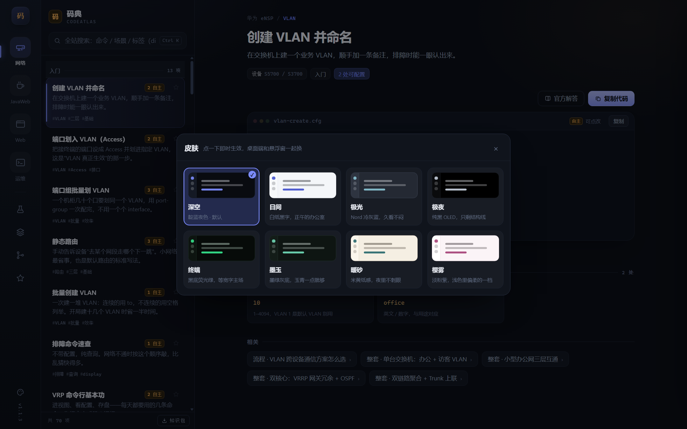

## 皮肤包：8 套配色

以前只有深色 / 浅色两档，左轨底部一个太阳月亮按钮来回切。现在换成调色盘按钮，点开挑一套，即时生效。

| 皮肤 | 底色 | 适合 |
|---|---|---|
| 深空 | 靛蓝夜色 | 默认，暗环境 |
| 日间 | 白纸黑字 | 白天、投屏 |
| 极光 | Nord 冷灰蓝 | 久看不闷 |
| 极夜 | 纯黑 OLED | 夜间、省电屏 |
| 终端 | 黑底荧光绿 | 喜欢终端质感 |
| 墨玉 | 墨绿灰 + 玉青 | 低对比、温润 |
| 暖砂 | 米黄纸感 | 长时间看代码 |
| 樱雾 | 淡粉紫 | 浅色里偏柔的一档 |



## 透明悬浮窗没被牺牲

这是这次改动里最要紧的一条。悬浮窗（`Ctrl+Alt+X` 叫出来的那张卡片）本来就是半透明的，
能看见下面的 eNSP / IDEA。换肤最容易踩的坑是：卡片底色跟着皮肤变了，但那层半透明是
按旧皮肤的颜色算的，于是要么灰得发脏，要么干脆变成一块不透明。

改法是让卡片底色直接吃界面底色：

```css
background: rgba(var(--hud-rgb), var(--hud-a, .92));          /* 老 WebView 兜底 */
background: color-mix(in srgb, var(--bg) calc(var(--hud-a, .92) * 100%), transparent);
```

皮肤换到哪套，卡片就跟到哪套，不依赖有没有人记得同步一个 rgb 三元组。

实测（`_dev/check-hud-alpha.py` 直接读截图 PNG 的 alpha 通道）：

- 四个圆角处 alpha 均值 4~12 —— 那是圆角抗锯齿的残留，圆角外是真的透明；
- 卡片内部 alpha 235 = 92%，和菜单里选的不透明度一致；
- 卡片底色 rgb 与该皮肤 `--bg` 完全一致（极光 / 墨玉 / 暖砂 / 终端逐套验过）。

另外用真屏 A/B 采样验过：窗口圆角处的物理像素和「显示前」的桌面壁纸一致，
说明 Windows 合成器真的让桌面透了过来，不是渲染层自己画了个透明色。

## 细节

- **桌面端换肤，已经开着的悬浮窗跟着变**（第二个窗口走 `storage` 事件），不用关掉重开。
- **升级不变样**：旧版只存 `dark` / `light`，会自动映射到深空 / 日间；没手选过就跟随系统深浅色。
- 顺手修掉两个老问题：浅色下「已选中的分段按钮」是白字配浅蓝底（几乎看不见）；
  安卓状态栏底色换皮肤后会停在上一个颜色。

## 安装

| 平台 | 文件 |
|---|---|
| Windows | `CodeAtlas-Setup-1.1.4.exe` |
| Android | `app-debug.apk` |

覆盖安装即可，配置和导入的知识包都在 `%APPDATA%\CodeAtlas`，不会丢。
